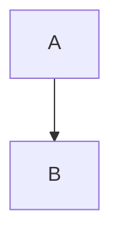

# Valence — Test Plan

How to run the build and what to verify. Each section is self-contained so you can skip
anything that does not matter to you.

## 0. Getting started

1. Download `Valence-0.1.0-win.zip` from the release page.
2. Extract anywhere. **Do not run it from inside the zip** — Windows Defender SmartScreen blocks
   that path; extract first.
3. Run `Valence.exe`. No install, no registry entries, no Start menu entry.
4. On first launch you get the welcome document. The window title should read "Valence".

## 1. Launch and shell (2 min)

- [ ] Window opens without a console window or error dialog.
- [ ] The rail on the left shows five icons: V mark (top), Files, Outline, Search, Settings (bottom), plus a theme toggle.
- [ ] Status bar at the bottom shows `Untitled · 258 words · Hybrid Source Split · All changes saved`.
- [ ] `Ctrl+/` toggles light/dark. Switching back and forth does not flicker.
- [ ] `Ctrl+,` opens settings. `Esc` closes it.

## 2. Typing and markdown (5 min)

Open a new document (`Ctrl+N` or `file.new` from the palette). Type:

```
# Title

A paragraph with **bold**, *italic*, `code`, and a [link](https://example.com).

- a list
- with two items

<|end|> a | b |
|---|---|
| 1 | 2 |

- [ ] task

```js
const x = 1
```

$x + y$

$$
E = mc^2
$$


```

- [ ] Headings render as headings, not `#` characters.
- [ ] Bold/italic/code render inline.
- [ ] The table renders with borders and is editable.
- [ ] The code block has syntax highlighting (JavaScript).
- [ ] Inline math renders as KaTeX.
- [ ] Display math renders as KaTeX.
- [ ] The Mermaid diagram renders **and does not leave the rest of the document blank while it loads.**
- [ ] Switch to Source view (`Ctrl+Shift+S`? no — `Ctrl+\` cycles; use the Source button). The source shows the original markdown, not HTML.
- [ ] Switch back to Hybrid. The document is unchanged.
- [ ] `Ctrl+Z` / `Ctrl+Shift+Z` undo and redo work.

## 3. Slash commands

In a fresh paragraph, type `/`:

- [ ] A menu opens near the caret.
- [ ] Typing `hea` narrows to the three headings.
- [ ] Typing `zzz` shows "No command matches".
- [ ] `Enter` inserts the selected item and removes the `/...` token.
- [ ] `Escape` closes without inserting.
- [ ] Arrow keys move the selection.
- [ ] Inserting `Table` creates a 2x2 table with a header row.
- [ ] Inserting `Code block` creates a fenced code block.
- [ ] Inserting `Math block` creates a ` ```math ` fence.

## 4. Command palette

- [ ] `Ctrl+P` opens the palette. Input is focused.
- [ ] Typing `exp` ranks "Export" first.
- [ ] Typing `word` finds "Export" via its keyword.
- [ ] Arrow keys move; Enter runs and closes.
- [ ] Esc closes.
- [ ] Clicking the backdrop closes; clicking inside does not.

## 5. Smart paste

Copy this HTML from a browser and paste into Valence:

```
<h2>Pasted</h2>
<ul><li>one</li><li>two</li></ul>
<table><tr><th>a</th><th>b</th></tr><tr><td>1</td><td>2</td></tr></table>
```

- [ ] Heading arrives as a heading, not `## Pasted`.
- [ ] List arrives as a list, not `one\ntwo`.
- [ ] Table arrives as a table.
- [ ] Paste an image from the clipboard (Snipping Tool → copy). It lands beside the document as `pasted-*.png` and renders inline.

## 6. Export

- [ ] `Ctrl+E` opens the Export dialog.
- [ ] PDF export produces a PDF with the rendered document (fonts, code, math).
- [ ] HTML export produces a single HTML file.
- [ ] Pandoc formats (Word/EPUB/LaTeX) are shown **disabled** with "Pandoc is not installed" rather than failing on click. (Install Pandoc and verify they work.)

## 7. Files and workspace

- [ ] `Ctrl+Shift+O` (or the palette's "Open workspace") opens a folder picker.
- [ ] After picking a folder, the Files panel shows the tree rooted there.
- [ ] The Tree/List toggle swaps between a nested tree and a flat sorted list.
- [ ] Search box filters the tree without losing folder structure.
- [ ] Opening a file from the tree loads it in a new tab.
- [ ] Multi-tab: `Ctrl+Alt+→` / `←` switches tabs. `Ctrl+W` closes.
- [ ] Dirty documents show the dirty indicator; closing asks to discard.

## 8. Wiki links and backlinks

Create two files in the same folder, `A.md` and `B.md`. In A, type `[[B]]`. Save both.

- [ ] `[[B]]` renders as a dotted link showing "B".
- [ ] Clicking it opens B.
- [ ] `[[Missing]]` renders as a link; clicking it creates `Missing.md` with `# Missing` and opens it.
- [ ] In B's outline panel, A appears under Backlinks.
- [ ] Clicking the backlink opens A.
- [ ] `[[B|an alias]]` renders as "an alias".
- [ ] Round-trip: save A, reopen, the link is still `[[B]]` (not mangled).

## 9. Version history

- [ ] `Ctrl+H` opens the history panel.
- [ ] With an unsaved document, "No snapshots yet" is shown.
- [ ] Save the document (`Ctrl+S`), then edit and save again. Two snapshots.
- [ ] Selecting the older one shows a unified diff with `+`/`-` lines and counts.
- [ ] "Restore this version" replaces the document with the picked version.
- [ ] Snapshots are stored next to the note under `.valence/`.

## 10. Settings

- [ ] Theme: System / Light / Dark.
- [ ] Tab bar location: top / bottom / hidden.
- [ ] Focus mode dims non-active paragraphs.
- [ ] Typewriter mode pins the current line to the centre.
- [ ] Daily word goal shows progress in the inspector.
- [ ] Show inspector toggles the right panel.
- [ ] Custom CSS: paste `body { background: red }` and the editor background changes; clearing it reverts.

## 11. Edge cases worth a look

- [ ] A document with no front matter, no headings, just prose — opens and saves cleanly.
- [ ] A document with CJK text and emphasis (`**强调**`) — emphasis renders and round-trips.
- [ ] A 10,000-word document — typing stays responsive (no lag).
- [ ] A document with a malformed table (ragged rows) — renders without crashing.
- [ ] Open a folder with 1,000+ markdown files — the tree builds without hanging.

## 12. Known gaps (do not file as bugs yet)

- Mermaid diagrams may not render in this build (dev-mode latency was minutes; production should be faster, unverified).
- Layout has been measured but never eyeballed. No one has looked at a rendered window.
- Table toolbar pointer behaviour is unverified end-to-end (synthetic events cannot drive `posAtCoords`).
- Print/PDF pagination is unexercised.
- Pandoc paths require Pandoc installed.
- Theme gallery is "paste into Custom CSS" only; no preset UI.
- Plugin API, AI assistance, and version-history diff are the M5 leftovers.

## 13. Already covered by the build probe

These are machine-checked on every packaged build (`pnpm verify:package`), so if one of
them is broken you will be told rather than having to notice:

- The app launches and opens a window.
- The preload bridge loads — this failed in every build before v0.1.7.
- `window.valence` is present and a write/read round-trips through it.
- No console errors and no uncaught exceptions during a cold start.
- Tailwind utilities are actually applied in the packaged renderer.
- Shiki's lazy grammar chunks resolve over `file://`.

If you see a **red banner reading "Valence cannot reach your files"** at the top of the
window, stop and report it: the preload failed and nothing will be saved to disk.